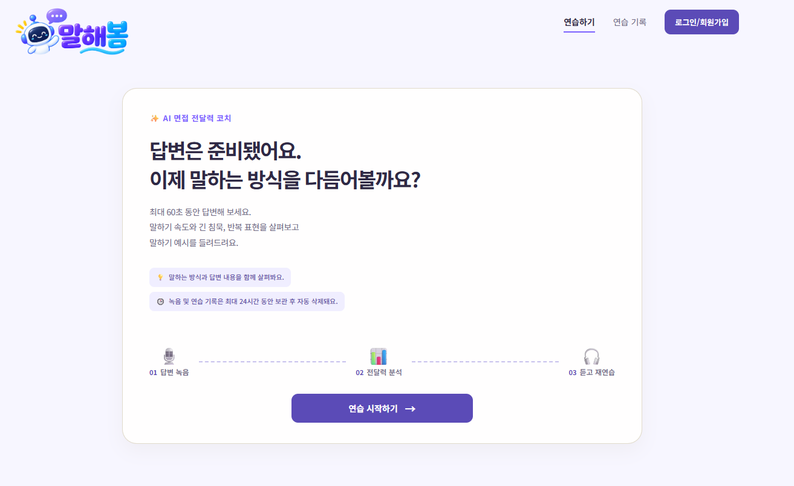
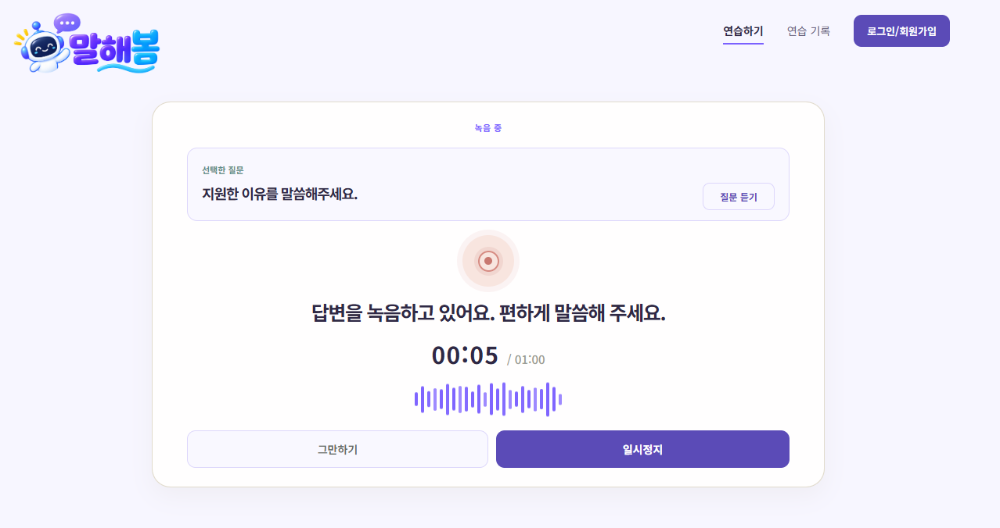
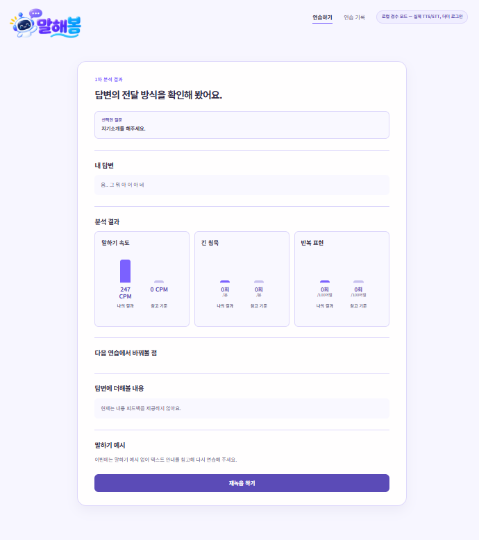

# 말해봄 Mk.2

신입 개발자 취업준비생이 한국어 면접 답변을 **녹음**하면, 말하는 방식(속도·침묵·반복 표현)을 분석하고 **답변에서 확인되는 근거**를 바탕으로 코칭해 다시 연습하게 돕는 면접 코칭 에이전트입니다.
React 웹 앱, STT·VAD 분석 API, Skill·MCP·LLM 코칭, 평가 자료를 함께 관리합니다. 이 프로젝트는 RAG를 사용하지 않습니다.

| 항목 | 내용 |
|---|---|
| 상태 | 수료 과정 2차 팀 프로젝트, 개발 종료 |
| 출처 | AI Human 7기 팀 프로젝트의 **공개용 사본**. 원본은 비공개 저장소 `aihuman-7th/proj2-3`(기준 커밋 `489b1bf`, 2026-10-12). 커밋 이력은 가져오지 않았고 팀원 동의를 받았습니다 |
| 팀 | 곽호준([@kwak317](https://github.com/kwak317)), 김재훈([@nanocode00](https://github.com/nanocode00)), 서정현([@SJeongHyeon](https://github.com/SJeongHyeon)). 서정현의 담당 범위와 기여는 [CONTRIBUTIONS.md](CONTRIBUTIONS.md) |
| 기술 | FastAPI · React + TypeScript + Vite · FastMCP(조회 도구 4개) · Skill·Prompt 분리 · Langfuse · Supabase · n8n · Cloud Run |

## 데모

| 시작 | 녹음 | 1차 분석 결과 |
|---|---|---|
|  |  |  |

- **소개페이지**: <https://malhaebom.xyz/> · 팀원이 만든 [소개 사이트](https://nanocode00.github.io/malhaebom-showcase/)
- **연습 시작**: <https://malhaebom.xyz/app/practice> (로그인 후 채팅)
- 위 주소는 2026-11-19에 접속해 200 응답을 확인했습니다. 팀원이 운영하는 배포라 언제까지 유지될지는 정해져 있지 않습니다. 열리지 않으면 위 화면과 아래 측정 결과를 참고하세요.

## 측정 결과

**아래 수치는 모두 합성 입력(실제 사용자 녹음 아님) 30건 기준의 자동 평가입니다.** 실제 사용자 품질 평가나 최신 운영 구성의 점수는 측정하지 않았습니다. 서로 다른 실행의 점수를 합치지 마세요. 자세한 조건은 [EVAL_REPORT.md](EVAL_REPORT.md)에 있습니다.

| 지표 | 값 | n · 조건 | 근거 |
|---|---|---|---|
| Prompt 전후 비교: 출력 계약 통과 | 양쪽 30/30 | 합성 30건씩. 2026-10-02. `coaching-user-supplied-v4-verification` → `coaching-v5-skill-owned`, 동일 Skill v6.1 | [EVAL_REPORT.md](EVAL_REPORT.md) |
| Prompt 전후 비교: 종합 자동 통과 | 22/30 → 20/30 | 위와 같은 실행 | 같은 문서 |
| 배포 구성 반복 평가: 출력 계약 통과 | 90/90 | 같은 합성 30건 × 3회. 2026-10-06. 당시 운영 구성(Prompt v4·Skill v6) | 같은 문서 |
| 배포 구성 반복 평가: 종합 자동 통과 | 57/90 | 위와 같은 실행 | 같은 문서 |
| 운영 확인: 요청 ID와 trace 연결 | 확인 | 2026-10-09. 사이트 채팅 200·입력 오류 422의 요청 ID와 Langfuse trace·Cloud Run 로그를 연결해 확인 | [증거 캡처](docs/evidence/assets/request-trace-linkage-2026-10-09.png) |

**종합 자동 통과의 기준**: 출력 계약, 적용 가능한 모든 판정, 지원 문장 근거, 질문·행동 대상 검사를 **모두** 충족한 케이스입니다([EVAL_REPORT.md](EVAL_REPORT.md) 3-1절). 같은 실행의 출력 계약 통과(90/90)는 JSON 형식 적합성이라 품질 지표가 아니며, 코칭 자유서술의 사람 품질 점수도 아닙니다.

## 사례 연구

- [Prompt v5 후보가 비용은 줄였지만 자동 판정이 후퇴해 승격을 보류한 일](docs/case-studies/prompt-v4-v5-candidate.md): 결정은 승격 보류(DISCARD)이고, 종합 자동 통과 22/30 → 20/30, 비용 약 13.3% 감소를 같은 표에 적었습니다.

## 구조

```text
backend/          FastAPI, STT·VAD 분석, LLM 호출 진입점
frontend/         React + TypeScript + Vite 웹 앱
skills/           면접 답변 판단 기준과 코칭 규칙
mcp_server/       FastMCP 조회 도구 4개와 HTTP·stdio transport
evals/            고정 평가셋, 과거 결과, 명시 선택 실험 후보
prompts/          Prompt 템플릿과 버전별 재현 자료
configs/          STT·TTS·질문 Rubric 설정
supabase/         DB와 비공개 Storage migration
docs/             최신 안내, 제출 증거, Spec, 실험 기록
```

서버 문맥 → `prompts/`의 운영 템플릿 + `skills/`의 도메인 규칙 → LLM → Pydantic·근거 검증 순서로 동작하며, 활성 기준과 판정은 서버에서도 검증합니다. 설계 설명은 [docs/ARCHITECTURE.md](docs/ARCHITECTURE.md), 신뢰 경계는 [docs/TRUST_BOUNDARY.md](docs/TRUST_BOUNDARY.md)에 있습니다.

## 주요 기능

1. NCS 역량 자기점검, 선택적 GitHub README·이력서 PDF 분석과 사용자 확인
2. 확인한 경험 기반 공고 추천·검색, 공고 원문 분석·요구사항 선택
3. 기본·직접 입력 질문, 녹음·WAV 제출, STT 원문 확인·수정·표준어 변환
4. 답변 근거 코칭, 자유채팅·동의 후 경험 반영, 재답변 비교·꼬리질문
5. 이력서 초안·문장 다듬기·PDF 다운로드, 연습 결과·채팅 조회·기록 삭제

## 한계

- 평가는 합성 입력 30건의 **자동 판정**입니다. 최신 운영 구성에 대한 사람의 품질 평가와 실제 마이크로 시작하는 전체 사용자 흐름의 성공률은 측정하지 않았습니다(과거 출력에 대한 사람 검토 기록은 [EVAL_REPORT.md](EVAL_REPORT.md)에 따로 있습니다).
- 평가 수치는 각 날짜·구성의 과거 실행 결과입니다. 현재 운영 구성의 새 점수가 아닙니다([EVAL_REPORT.md](EVAL_REPORT.md) 첫머리 참고).
- 추가 질문의 팀 초안 규칙은 외부 면접관 검수를 마친 것으로 표현하지 않습니다.
- 실제 로그인→음성 분석→코칭 전체 흐름의 재현에는 유효한 키와 DB migration이 필요해, 이 저장소만으로는 화면·API 기동까지만 재현됩니다.

## 실행

키 없이 가능한 것은 화면·API 기동과 단위 시험입니다. 전체 흐름에는 Supabase 주소·키, OpenRouter·NCS 키, MCP 비밀값이 필요하며 `.env.example`을 복사해 본인 값을 넣어 씁니다. 키는 저장소에 올리지 않습니다.

```bash
cp .env.example .env        # Windows PowerShell: Copy-Item .env.example .env
docker compose up           # 처음에는 이미지를 빌드합니다
```

- 포트가 사용 중이면 `.env`의 `WEB_PORT`, `API_PORT`를 바꿉니다.
- `STT_WARMUP_ENABLED=false`는 시작할 때 음성 모델 다운로드를 하지 않습니다. 첫 음성 분석에서 모델 준비 시간이 따로 듭니다.
- 새 clone 기동 시간과 검증 범위는 [재현 점검](docs/evidence/clean-compose-reproduction-20261010.md)에 있습니다.
- 단위 시험: `pip install -r backend/requirements-ci.txt` 후 `python -m pytest backend/tests -q`, 프론트엔드는 `npm ci --prefix frontend && npm --prefix frontend test` (CI와 같은 명령). Windows에서는 시간대 데이터가 없어 `pip install tzdata`를 추가로 해야 합니다.
- 이 사본에서 키 없이 다시 실행한 결과(2026-11-19): 백엔드 `846 passed, 2 skipped`, 프론트엔드 `46개 파일 279개 테스트 통과`와 `npm run build` 성공. 프론트엔드는 Node 26으로 돌렸고 CI는 Node 22.14를 씁니다.

## 데이터와 출처

코칭의 지식·기술·태도 선택 문구는 NCS(국가직무능력표준) 응용SW엔지니어링 기준 정보를 참고해 작성했습니다. 도메인 자료의 출처와 이용 조건은 [docs/research/DOMAIN_SOURCE_REGISTER.md](docs/research/DOMAIN_SOURCE_REGISTER.md)에 정리돼 있습니다. 평가용 입력은 합성 데이터이며, 개인 음성 원본과 키는 저장소에 포함하지 않았습니다.

## 문서

[docs/DECISIONS.md](docs/DECISIONS.md)(의사결정) · [docs/CURRENT_STATE.md](docs/CURRENT_STATE.md)(현재 상태) · [docs/SUBMISSION_EVIDENCE.md](docs/SUBMISSION_EVIDENCE.md)(제출 증거) · [evals/README.md](evals/README.md)(평가 안내) · [skills/interview-coach/SKILL.md](skills/interview-coach/SKILL.md)(코칭 규칙) · [AGENTS.md](AGENTS.md)

이 사본에서는 개발 중 작업 로그와 과정 내부 문서를 제외했습니다.

## 라이선스

정해지지 않았습니다(팀 합의 필요). 지정 전에는 열람 목적으로만 공개합니다. 글꼴 `NanumGothic`은 [OFL](frontend/public/fonts/NanumGothic-OFL.txt)을 따릅니다.
